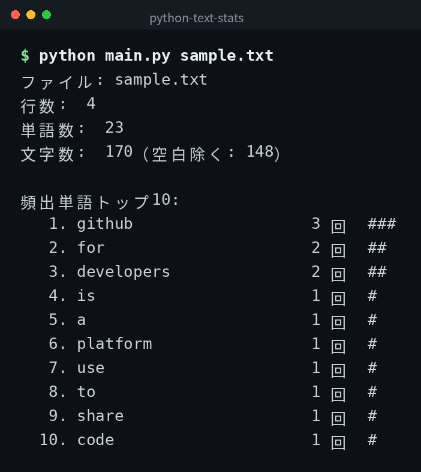

English | [日本語](ja/README.md) | [한국어](ko/README.md)

# python-text-stats


## Overview

A tool that reads text files and displays the number of lines, words, and characters, along with the top 10 most frequent words. It also supports Japanese text.

## Demo



*Actual output. The CLI interface is in Japanese.*

## Features

- Display line, word, and character counts
- Display the top 10 most frequent words
- Supports Japanese text
- Analyze multiple files at once

## Requirements

- Python 3.6 or higher

## Quick Start

```bash
git clone https://github.com/mivork/python-text-stats.git
cd python-text-stats
python main.py sample.txt
python main.py a.txt b.txt
```

## Usage

| Command | Description |
|---|---|
| `python main.py <file>` | Analyze a single file |
| `python main.py <file1> <file2>` | Analyze multiple files at once |

## Example Output

The program prints its results in Japanese, as shown below.

```
ファイル: sample.txt
行数:  3
単語数:  10
文字数:  50（空白除く: 45）

頻出単語トップ10:
   1. hello                 3 回  ###
   2. world                 2 回  ##
```

## Data Format

This tool does not save data to a file. It reads the specified text file and prints the analysis results to standard output.

### Word Detection

A sequence of alphanumeric characters counts as one word. A sequence of hiragana, katakana, or kanji characters also counts as one word.

## License

This project is licensed under the MIT License.
