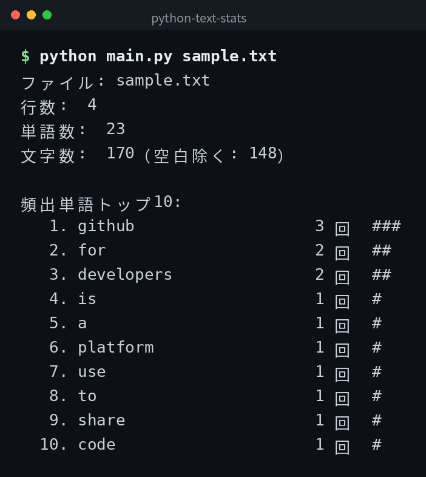

[English](../README.md) | 日本語 | [한국어](../ko/README.md)

# python-text-stats


## 概要

テキストファイルを読み込み、行数・単語数・文字数・頻出単語トップ10を表示するツールです。日本語テキストにも対応しています。

## デモ



## Features

- 行数・単語数・文字数を表示する
- 頻出単語トップ10を表示する
- 日本語テキストに対応する
- 複数ファイルをまとめて解析する

## 必要環境

- Python 3.6 以上

## Quick Start

```bash
git clone https://github.com/mivork/python-text-stats.git
cd python-text-stats
python main.py sample.txt
python main.py a.txt b.txt
```

## 使い方

| コマンド | 説明 |
|---|---|
| `python main.py <ファイル>` | 単一ファイルを解析する |
| `python main.py <ファイル1> <ファイル2>` | 複数ファイルを解析する |

## 出力例

```
ファイル: sample.txt
行数:  3
単語数:  10
文字数:  50（空白除く: 45）

頻出単語トップ10:
   1. hello                 3 回  ###
   2. world                 2 回  ##
```

## データ形式

このツールはファイルにデータを保存しません。指定されたテキストファイルを読み込み、解析結果を標準出力に表示します。

### 単語の判定

英数字の連続と、ひらがな・カタカナ・漢字の連続をそれぞれ1単語として数えます。

## ライセンス

このプロジェクトは MIT ライセンスの下で公開されています。
