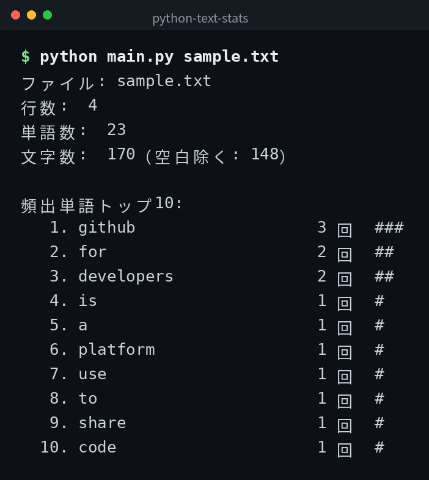

[English](../README.md) | [日本語](../ja/README.md) | 한국어

# python-text-stats


## 개요

텍스트 파일을 읽어 줄 수, 단어 수, 문자 수와 빈출 단어 상위 10개를 표시하는 도구입니다. 일본어 텍스트도 지원합니다.

## 데모



*실제 출력입니다. CLI 인터페이스는 일본어입니다.*

## Features

- 줄 수, 단어 수, 문자 수를 표시한다
- 빈출 단어 상위 10개를 표시한다
- 일본어 텍스트를 지원한다
- 여러 파일을 한 번에 분석한다

## 요구 사항

- Python 3.6 이상

## Quick Start

```bash
git clone https://github.com/mivork/python-text-stats.git
cd python-text-stats
python main.py sample.txt
python main.py a.txt b.txt
```

## 사용법

| 명령어 | 설명 |
|---|---|
| `python main.py <파일>` | 단일 파일을 분석한다 |
| `python main.py <파일1> <파일2>` | 여러 파일을 분석한다 |

## 출력 예시

프로그램은 아래와 같이 일본어로 결과를 출력합니다.

```
ファイル: sample.txt
行数:  3
単語数:  10
文字数:  50（空白除く: 45）

頻出単語トップ10:
   1. hello                 3 回  ###
   2. world                 2 回  ##
```

## 데이터 형식

이 도구는 파일에 데이터를 저장하지 않습니다. 지정된 텍스트 파일을 읽어 분석 결과를 표준 출력에 표시합니다.

### 단어 판정

연속된 영숫자와 연속된 히라가나, 가타카나, 한자를 각각 하나의 단어로 판정합니다.

## 라이선스

이 프로젝트는 MIT 라이선스 하에 공개되어 있습니다.
